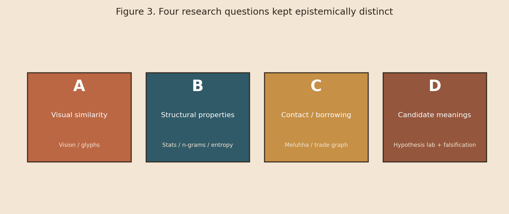

# Motivation & Research Gap

## Why Indus remains hard

Mature Harappan inscriptions are typically very short; many appear on seals and tablets with uncertain reading direction; the underlying language (if linguistic at all in every use) is unknown; and no Rosetta-like bilingual has been recovered.

That combination creates a **methodological vacuum** filled by:

* Visual lookalike arguments across Egypt, Mesopotamia, and later scripts
* Uncontrolled statistical “pattern” claims
* Language-family advocacy without chronological / archaeological controls
* Public “translations” that omit negative evidence

## Gap this platform fills

Prior tools often optimise for **one** channel (images, or n-grams, or a preferred language family). IndusScript AI instead implements a **multi-channel, falsification-first** workflow:

<figure><figcaption>
Figure 3. Questions A–D are colour-coded and never silently conflated in the software or UI.
</figcaption></figure>

## Design principles

1. **Epistemic labelling** everywhere (observed / computational / hypothesis / speculative / validated)
2. **Provenance before convenience** (unavailable sources are logged, not fabricated)
3. **Synthetic data only when labelled** (`SYNTHETIC`) for software testing
4. **Null models are mandatory** before any similarity is celebrated
5. **Public demos inherit the same warnings** as the research dashboard
