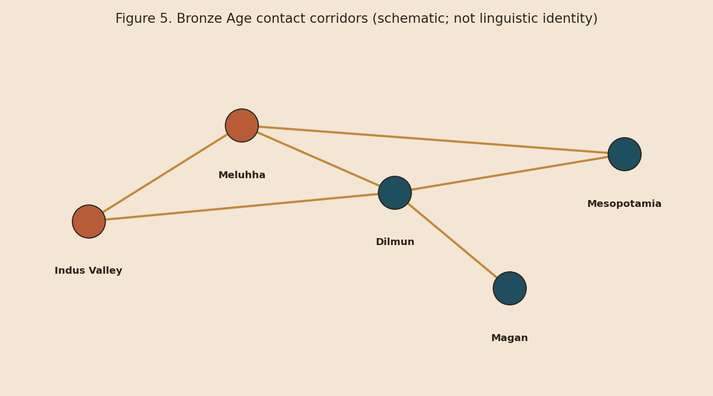

# Background: Indus, Meluhha & Comparanda

## Indus Valley writing

The IVC script is attested mainly in the third–early second millennium BCE across urban centres such as Mohenjo-daro, Harappa, Dholavira, and related sites. Object types include seals, tablets, and other inscribed artefacts. Scholarly inventories differ; the platform therefore treats sign identifiers as **catalogue tokens** pending curator-approved merges.

## Meluhha in Mesopotamian records

Akkadian and Sumerian administrative and literary traditions refer to **Meluhha**, often discussed by historians as a trade partner linked—debatedly—to the Indus region. Mentions of Meluhhan people, goods, and occasionally interpreters are historically important for **contact** (Question C), not automatic language identification for Indus inscriptions (Question D).

<figure><figcaption>
Figure 5. Schematic Dilmun–Magan–Meluhha–Mesopotamia corridors encoded in the platform’s NetworkX graph.
</figcaption></figure>

## Comparative corpora included as modules

| Module | Role |
| --- | --- |
| Sumerian / Akkadian / Babylonian | Administrative & lexical comparanda; Meluhha search |
| Egyptian (hieroglyphic / related) | Labelled vision benchmark + structural contrast |
| Linear B | Deciphered Aegean control for method checks |
| Proto-Dravidian / Munda stubs | Hypothesis frames only; cited reconstructions required for research use |


Comparative inclusion is **not** an argument that Indus encodes Egyptian, Sumerian, or Linear B. Controls exist precisely to measure generic ancient-script similarities.

