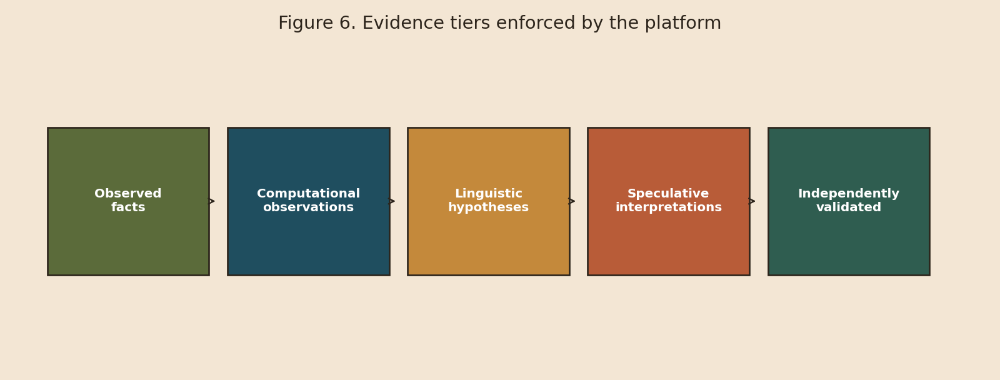

# Research Questions (A–D)

Every analysis page and report tags which question it addresses.

| ID | Question | Typical modules | Common misuse to avoid |
| --- | --- | --- | --- |
| **A** | Are symbols visually similar? | `vision/`, glyph proxies | Inferring sound or meaning from shape |
| **B** | Do systems share structural properties? | frequency, n-grams, entropy, embeddings | Treating JS/entropy match as relatedness proof |
| **C** | Is there contact, borrowing, or intermediaries? | Meluhha DB, trade graph | Equating Meluhha with Indus language ID |
| **D** | Can sequences get defensible candidate meanings? | hypothesis lab, speculative translator | Publishing fluent English as fact |

<figure><figcaption>
Figure 6. Evidence tiers from observed facts to independently validated conclusions.
</figcaption></figure>

## Worked example of separation

A high cosine between an Indus fish-like motif and an Egyptian fish hieroglyph answers **A** only.\
Matching rank-frequency curves answers **B** only.\
A Ur III tablet mentioning Meluhha answers **C** only.\
A candidate Proto-Dravidian gloss for a recurring bigram is **D**, and remains speculative until external validation.
