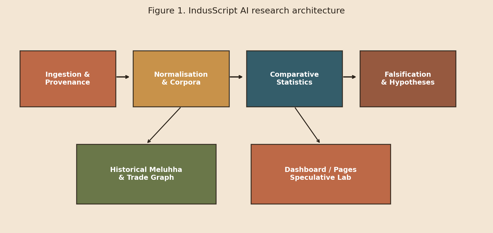

# Platform Architecture

<figure><figcaption>
Figure 1. End-to-end modules.
</figcaption></figure>

## Layered design

| Layer | Package | Responsibility |
| --- | --- | --- |
| Config | `config/` | Paths, integrity notice, research questions |
| Ingestion | `ingestion/` | Source adapters, retries, provenance registry |
| Storage | `database/` | SQLite schema; raw payloads ≠ normalised rows |
| Normalisation | `normalisation/` | Per-civilisation sign maps; no silent cross-merges |
| Corpora | `corpora/` | Loaders for analysis |
| Analysis | `analysis/` | Frequency, n-grams, position, entropy, embeddings, structure |
| Historical | `historical/` | Meluhha search + trade network |
| Hypotheses | `hypotheses/` | Language scores, interpretations, falsification, speculative lab |
| Vision | `vision/` | CV pipeline + glyph rendering for UI |
| Presentation | `dashboard/`, `docs/` | Streamlit parchment UI + GitHub Pages demo |
| Reports | `reports/` | JSON / CSV / Markdown exports |

## Unified record fields

Each normalised inscription carries: `record_id`, civilisation, language, writing system, transliteration, translation (status-gated), sign sequence, direction, dating, geography, site, object type, source & image refs, confidence, uncertainty annotations, synthetic flag.


Indus translations default to status `none` and are never stored as attested facts when invented.

