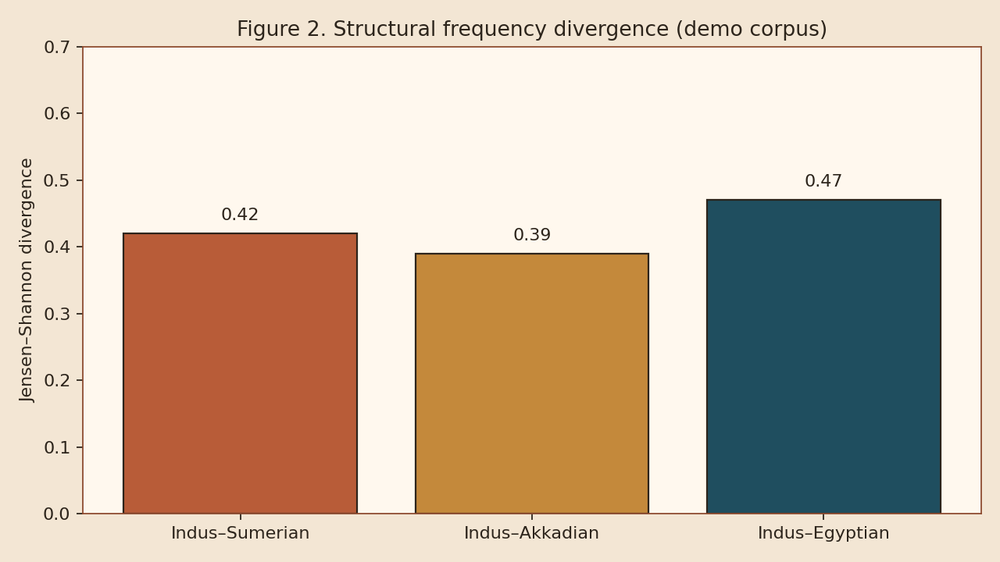
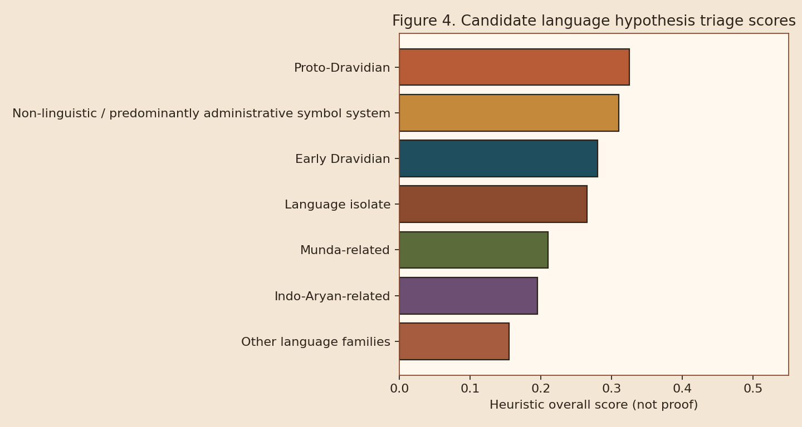

# Methods: Statistics, History, Hypotheses

## Comparative statistics (Question B)

* **Frequency:** absolute / relative frequencies, rank-frequency, rare signs, site stratification; **Jensen–Shannon divergence** across corpora
* **N-grams:** 1–4 grams, conditional probabilities, repeated sequences
* **Positional analysis:** \(P(\mathrm{sign}\mid \mathrm{beginning/middle/ending})\); dual orientation when direction unknown
* **Information theory:** Shannon entropy, conditional entropy, mutual information, complexity proxies
* **Embeddings:** per-corpus Word2Vec / FastText (Gensim) with NumPy co-occurrence SVD fallback; Procrustes alignment only with analyst anchors
* **Structure reports:** length distributions, repetition rates, transition samples

<figure><figcaption>
Figure 2. Example structural divergence scores on the demonstration corpus (not semantic similarity).
</figcaption></figure>

## Historical contact engine (Question C)

* Meluhha evidence objects: text, transliteration, translation, date, citation, location, people, commodities, interpreter flag, confidence, tier
* Keyword flagging for Meluhha / interpreter / Dilmun–Magan trade vocabulary
* NetworkX graph of Indus–Meluhha–Dilmun–Magan–Mesopotamia relations with confidence attributes

## Hypothesis engine (Question D)

Candidate frames include Proto-Dravidian, Early Dravidian, Munda-related, Indo-Aryan-related, other, isolate, and non-linguistic/administrative.

Each is scored on ten criteria (chronology, geography, contact, vocabulary, phonology, morphology, grammar, repeated patterns, archaeology, independent validation). Scores are **transparent heuristics for triage**, not posterior probabilities.

<figure><figcaption>
Figure 4. Heuristic ranking of language-family hypotheses on default priors (independent validation near zero for all).
</figcaption></figure>
