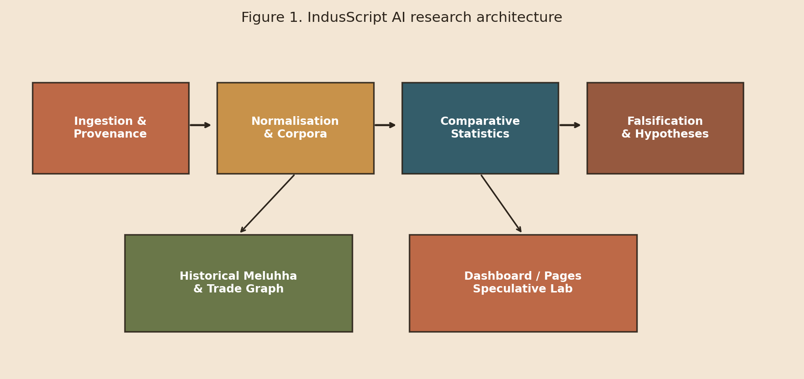

# IndusScript AI

## A Computational Platform for Comparative Hypothesis Testing on the Undeciphered Indus Writing System


**Integrity statement.** This white paper does **not** claim that the Indus script has been deciphered. Similarity scores, embeddings, Meluhha references, and “assumed translations” are **research hypotheses** for evaluation — not established phonetics, grammar, or ancestry.


<figure><figcaption>
Figure 1. Modular research architecture from provenance-aware ingestion through falsification and public demos.
</figcaption></figure>

### Abstract

The writing system of the Indus Valley Civilisation (IVC) remains one of the outstanding open problems in historical linguistics and computational epigraphy. Progress is hindered by short inscriptions, uncertain language identity, the absence of a bilingual key, and the risk that visual or statistical similarities are over-interpreted as decipherment.

**IndusScript AI** is an open research platform that makes those risks *methodologically visible*. It supports:

1. Provenance-tracked ingestion of comparative corpora (Indus, Sumerian/Akkadian, Egyptian, Linear B, reconstructed lexicon stubs)
2. Sign normalisation that forbids silent cross-civilisation merges
3. Comparative statistics (frequency, n-grams, position, entropy, embeddings, structural divergence)
4. Meluhha / Dilmun / Magan trade-contact indexing with NetworkX graphs
5. Candidate language hypothesis scoring with explicit criteria
6. Mandatory statistical falsification (shuffles, permutations, FDR correction)
7. A labelled **Speculative Translation Lab** (Streamlit + public GitHub Pages demo)

### Document metadata

| Field | Value |
| --- | --- |
| Title | IndusScript AI White Paper |
| Audience | Universities, epigraphy labs, digital humanities centres, computational linguistics groups |
| Version | 1.0 |
| Date | 31 October 2026 |
| Code | [github.com/AmmarJamshed/indusscript-ai](https://github.com/AmmarJamshed/indusscript-ai) |
| Public demo | [ammarjamshed.github.io/indusscript-ai](https://ammarjamshed.github.io/indusscript-ai/) |
| Stack | Python 3.12 · SQLite · Streamlit · SciPy/NetworkX/Gensim · OpenCV |

### Colour legend used in this paper

| Colour cue | Meaning |
| --- | --- |
| Terracotta | Indus / primary research accent |
| Seal teal | Comparative structure / Mesopotamia–Egypt panels |
| Ochre | Contact, trade, caution |
| Clay brown | Limitations, non-claims, falsification |

### Quick navigation

* [Executive Summary for Universities](01-executive-summary.md)
* [Research Questions (A–D)](04-questions.md)
* [Falsification Framework](08-falsification.md)
* [Why Universities Should Engage](11-university-case.md)
* [Reproduce & Cite](15-reproduce.md)
